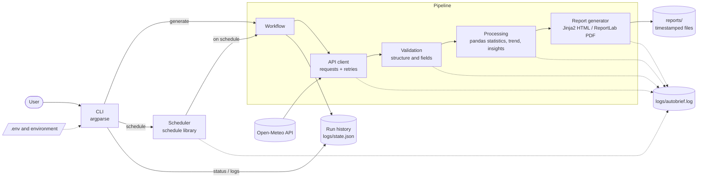

# AutoBrief — Automated Intelligence Report Generator

AutoBrief is a Python command-line application that pulls live data from a public API, validates and analyses it, and turns it into a professional **HTML and PDF report** — on demand or automatically on a schedule.

```
API → Data Collection → Validation → Processing → Analysis → Report Generation → Scheduling → Logging
```

## Overview

Manually collecting data, calculating the numbers and formatting a briefing is repetitive work. AutoBrief automates the whole chain. This version reports on the **weather forecast** for a configurable location using the free [Open-Meteo](https://open-meteo.com/) API (no account or API key needed). It computes statistics and trends from the raw data and writes plain-language insights next to charts and tables.

The API client, analysis engine and report generator are separate layers, so the data source can be swapped without touching the rest of the application.

## Features

- **Live API collection** through a dedicated client: configurable endpoint, timeouts, automatic retries with backoff (timeouts, network errors, HTTP 429/5xx), structural response validation.
- **Data processing with pandas**: cleaning, type coercion, field validation, dropping impossible rows (e.g. low > high), statistics, a linear temperature trend and auto-generated insights.
- **Reports in HTML and PDF**: title, timestamp, data source, executive summary, key metrics, two charts, data table, insights. HTML is self-contained (charts embedded) and print-friendly.
- **Timestamped output** in `reports/`, e.g. `reports/autobrief_2026-10-04_11-30.pdf`. Existing files are never overwritten.
- **CLI** (`generate`, `schedule`, `status`, `logs`) with help for every command.
- **Scheduler**: daily at a fixed time or every N minutes. A failed run is logged and recorded, and the scheduler keeps running.
- **Logging** to `logs/autobrief.log` (rotating file) with credential redaction.
- **Error handling**: network failure, timeout, HTTP errors, invalid JSON, missing fields, empty data, file-write errors, bad CLI arguments, scheduler errors — all shown as short messages instead of tracebacks.
- **Run history** (`autobrief status`): last run, success/failure counts, scheduler heartbeat.
- **Tests**: 92 pytest tests; the live API is always mocked.

## Architecture



Solid arrows are the data flow; dotted arrows are logging and configuration. Both `generate` and the scheduler call the same `run_workflow()` function, so logging and run-history recording exist in one place only.

## Tech Stack

| Library | Why it is used |
|---|---|
| `requests` | HTTP client with timeouts and straightforward error types |
| `pandas` | cleaning, validating and summarising the daily records |
| `matplotlib` | report charts (headless `Agg` backend, no display needed) |
| `Jinja2` | HTML report template with automatic escaping of untrusted text |
| `ReportLab` | PDF generation without external system dependencies |
| `python-dotenv` | loading `.env` configuration |
| `schedule` | lightweight in-process scheduling — no cron, Celery or Docker required |
| `argparse` (stdlib) | CLI, so no extra dependency |
| `logging` (stdlib) | rotating file log |
| `pytest`, `responses`, `pypdf` (dev) | tests, HTTP mocking, verifying PDF content |

## Project Structure

```text
autobrief/
├── src/autobrief/
│   ├── cli.py                  # argparse commands and terminal output
│   ├── config.py               # environment/.env settings with validation
│   ├── exceptions.py           # error hierarchy, each with a user-facing hint
│   ├── workflow.py             # fetch → process → report (+ run history)
│   ├── api/client.py           # the only module that knows the API
│   ├── processing/analyzer.py  # cleaning, statistics, trend, insights
│   ├── reports/                # generator.py, charts.py, templates/report.html.j2
│   ├── scheduler/scheduler.py  # daily / interval scheduling
│   └── utils/                  # logger.py (redacting), state.py (run history)
├── tests/                      # API, processing, reports, CLI, scheduler, config
├── scripts/mock_api_server.py  # offline mock of the API for demos (dev only)
├── examples/                   # sample reports (synthetic data, see below)
├── reports/  logs/             # generated output (git-ignored)
├── .env.example  .gitignore  pyproject.toml  LICENSE
```

## Installation

Requires **Python 3.11+**.

```bash
git clone <repository-url>
cd autobrief
python -m venv .venv
```

Activate the environment:

```bash
# macOS / Linux
source .venv/bin/activate
```

```powershell
# Windows (PowerShell / cmd)
.venv\Scripts\activate
```

Install the package (and the CLI command `autobrief`):

```bash
pip install -e .
autobrief --help
```

To run the tests as well, install the dev extras: `pip install -e ".[dev]"`.

## Configuration

Settings are read from environment variables. A `.env` file in the working directory is loaded automatically; real environment variables take precedence. Every setting is optional.

```bash
cp .env.example .env      # Windows: copy .env.example .env
```

| Variable | Default | Meaning |
|---|---|---|
| `AUTOBRIEF_API_URL` | `https://api.open-meteo.com/v1/forecast` | API endpoint |
| `AUTOBRIEF_LOCATION` | `London` | name shown in the report |
| `AUTOBRIEF_LATITUDE` / `AUTOBRIEF_LONGITUDE` | `51.5072` / `-0.1276` | coordinates (validated) |
| `AUTOBRIEF_FORECAST_DAYS` | `7` | 1–16 days |
| `AUTOBRIEF_TIMEOUT` | `10` | request timeout, seconds |
| `AUTOBRIEF_MAX_RETRIES` | `2` | retries for timeouts, network errors, HTTP 429/5xx |
| `AUTOBRIEF_API_KEY` | *(empty)* | optional, only for Open-Meteo's commercial plan |
| `AUTOBRIEF_REPORTS_DIR` / `AUTOBRIEF_LOGS_DIR` | `reports` / `logs` | output folders |
| `AUTOBRIEF_LOG_LEVEL` | `INFO` | `DEBUG`, `INFO`, `WARNING`, `ERROR` |

`--location`, `--latitude` and `--longitude` on `generate` / `schedule` override the configured location for a single command. **`.env` is git-ignored — never commit it.** The API key (if used) is never written to logs or shown in `repr(settings)`.

## Usage

```bash
autobrief --help                    # all commands
autobrief generate                  # HTML + PDF (default)
autobrief generate --format pdf
autobrief generate --format html
autobrief generate --location Paris --latitude 48.85 --longitude 2.35
autobrief status                    # last run, counts, scheduler state
autobrief logs                      # last 20 log lines
autobrief logs -n 50
autobrief generate --help           # command-specific help
```

Exit codes: `0` success, `1` runtime failure, `2` invalid command-line arguments.

## Scheduling

```bash
autobrief schedule --daily 09:00             # every day at 09:00 (24-hour, local time)
autobrief schedule --every 60 --format pdf   # every 60 minutes
autobrief schedule --daily 09:00 --run-now   # also generate one report right away
```

`schedule` runs in the **foreground** and uses the `schedule` library: it checks for due jobs every second, runs the full workflow when one is due, prints the result and logs it. A failed run (API down, disk error, even an unexpected bug) is logged and recorded and the scheduler **keeps running** and tries again at the next trigger. Stop it with `Ctrl+C` (or `SIGTERM`); it shuts down cleanly. While it runs, `autobrief status` shows it as active (heartbeat every 30 s).

The scheduler lives only as long as its process. To keep it running after you close the terminal, start it under a service manager (systemd, a Windows service, `nohup`/`tmux`), or alternatively skip `autobrief schedule` and let the OS call `autobrief generate` from cron / Windows Task Scheduler.

## Testing

```bash
pip install -e ".[dev]"
pytest
```

The 92 tests mock all HTTP traffic, so they run offline. They check calculated values against hand-computed results, retry/backoff behaviour, error classification, the content of generated HTML and PDF files, CLI exit codes and messages, and that the scheduler survives failed jobs.

For a manual offline demo, run the mock server in one terminal and point AutoBrief at it in another:

```bash
python scripts/mock_api_server.py
AUTOBRIEF_API_URL=http://127.0.0.1:8765/v1/forecast autobrief generate
```

The mock serves **synthetic** data and can also simulate failures (`/http500`, `/slow`, `/garbage`, `/bad-shape`, `/missing`).

## Example Output

```text
$ autobrief generate --format pdf

AutoBrief
────────────────────────────────────
✓ Data retrieved from Open-Meteo
✓ Data validated and processed
✓ Insights generated
✓ PDF report created

Report generated successfully!

Location:
reports/autobrief_2026-10-04_06-25.pdf
```

On failure:

```text
✗ Report generation failed

Reason: API request timed out.

Check your network connection, or increase AUTOBRIEF_TIMEOUT.
See logs/autobrief.log for details.
```

```text
$ autobrief status

AutoBrief status
────────────────────────────────────
Data source : Open-Meteo (London, 51.5072, -0.1276)
Reports     : 1 file(s) in reports/
Log file    : logs/autobrief.log
Scheduler   : running - daily at 06:30 (pid 483)
Total runs  : 1 (1 succeeded, 0 failed)
Last run    : 2026-10-04 06:30:00 - success (scheduled, 0.38s)
Last report : reports/autobrief_2026-10-04_06-30.pdf
```

A log excerpt from a scheduled run (`logs/autobrief.log`; long request line shortened):

```text
2026-10-04 06:30:00,611 | INFO     | autobrief.scheduler.scheduler | Scheduler execution started (daily at 06:30)
2026-10-04 06:30:00,611 | INFO     | autobrief.workflow | Report workflow started (trigger=scheduled, format=pdf, location=London)
2026-10-04 06:30:00,612 | INFO     | autobrief.api.client | API request: GET http://127.0.0.1:8765/v1/forecast params={'latitude': 51.5072, ...}
2026-10-04 06:30:00,615 | INFO     | autobrief.api.client | Data retrieved successfully: 7 daily records
2026-10-04 06:30:00,623 | INFO     | autobrief.processing.analyzer | Processing completed: 7 rows analysed, 5 insights
2026-10-04 06:30:00,991 | INFO     | autobrief.reports.generator | Report generated: reports/autobrief_2026-10-04_06-30.pdf (109072 bytes)
```

## Generated Reports

Reports are saved in `reports/` as `autobrief_YYYY-MM-DD_HH-MM.html` / `.pdf`. If a file for the same minute already exists, seconds are added to the name so nothing is overwritten. Files are written atomically (temp file, then rename), so a failed run never leaves a half-written report.

Sample reports are in [`examples/`](examples/). **They were generated from the offline mock server's synthetic data, not from the live API** (the filenames say so). Run `autobrief generate` with network access to produce a live one.

## Error Handling

Expected failures raise typed exceptions (`autobrief.exceptions`), each with a plain-language hint. The CLI turns them into a short message, writes the details to the log and exits with code 1 — no traceback for normal users.

| Situation | Behaviour |
|---|---|
| Network failure / timeout | retried with backoff (1 s, 2 s, …), then a clear message |
| HTTP 4xx | not retried; the API's own reason is shown |
| HTTP 429 / 5xx | retried, then reported |
| Invalid JSON / wrong structure / missing fields | rejected with the specific reason |
| Incomplete rows / impossible values | dropped and logged; the report notes how many |
| Empty dataset | clear error, no empty report is written |
| Report cannot be written | clear error, temp file cleaned up |
| Invalid CLI arguments / configuration | usage error (exit 2) / configuration error naming the variable |
| Failed scheduled run | logged and recorded; the scheduler continues |
| Unexpected bug | short message on screen, full traceback in the log |

## Future Improvements

These are **not implemented** — realistic next steps:

- Email delivery of generated reports
- Cloud storage upload (S3, Google Drive)
- Database persistence for historical trend analysis
- A web dashboard
- Additional API integrations (e.g. exchange rates) behind the same client interface
- Notifications (Slack / Telegram) on failed runs
- Running the scheduler as a managed background service

## License

MIT — see [LICENSE](LICENSE).
